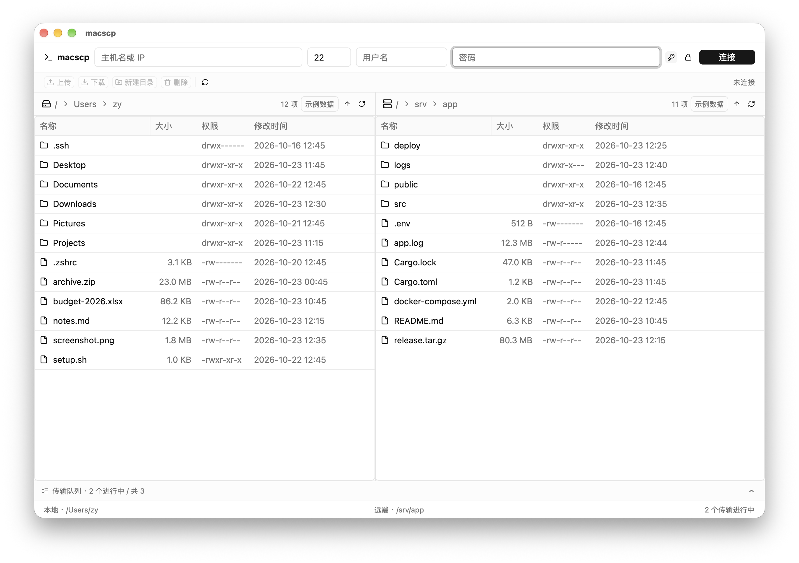
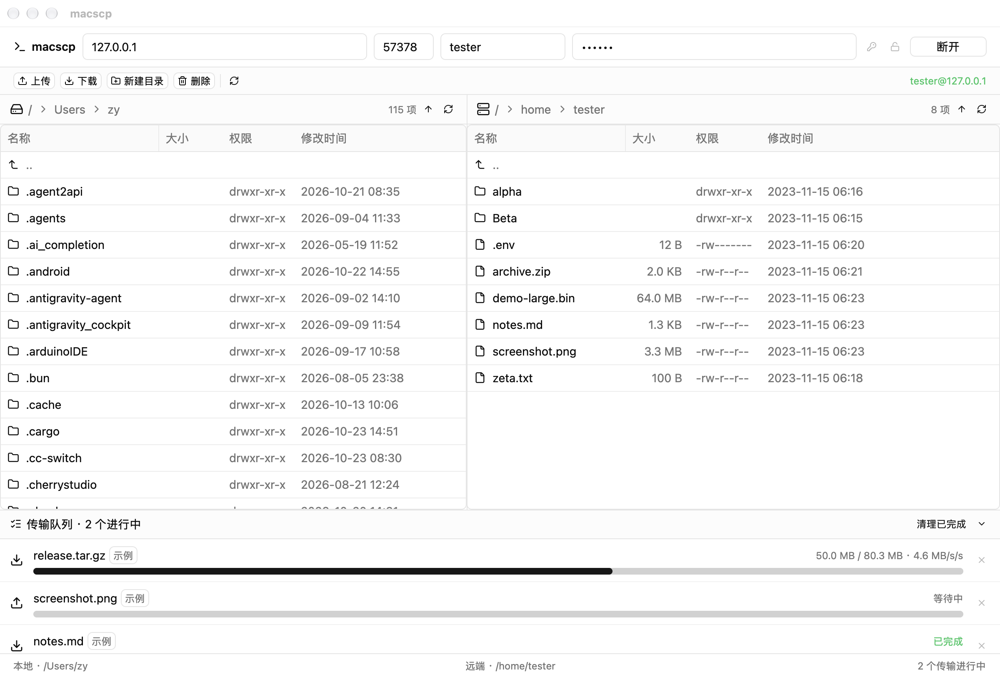
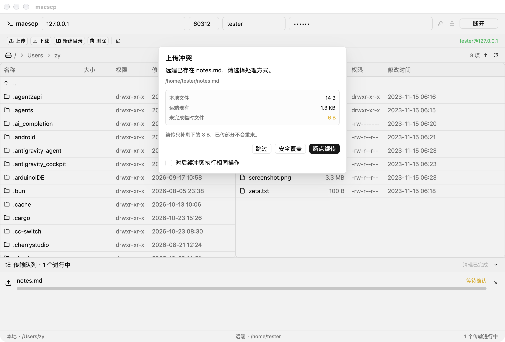
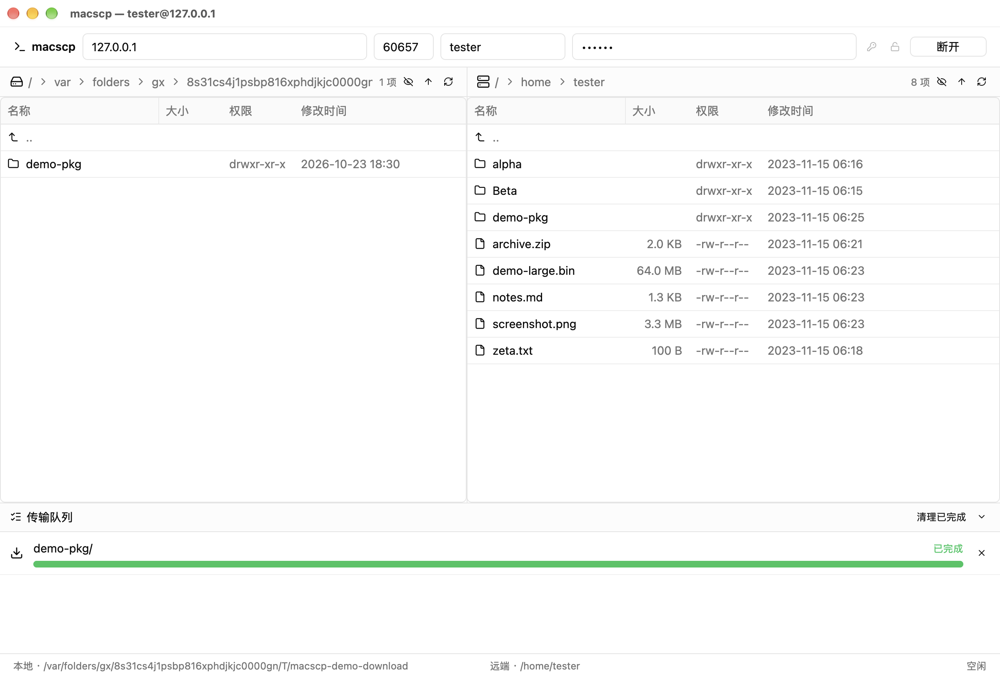

# macscp

原生 macOS SFTP 客户端：GPUI Kit 渲染 + 独立 Tokio 线程跑 `russh`。


> 左侧一启动就是真实磁盘（`std::fs` 后台读取），右侧在连上服务器前用 Mock 数据占位
> （面板右上角的「示例数据」角标），连接成功后自动切到服务器目录。两侧列表第一行的
> `↰ ..` 是「返回上一级」。



```
┌──────────────────────────── GPUI 主线程 ────────────────────────────┐
│  ScpApp                                                             │
│   ├─ Toolbar           ── Host/Port/User/Password + 连接/断开        │
│   └─ Workspace         ── v_resizable（上双栏 / 下队列）             │
│        ├─ FilePane(local)   ── TableState<FileTable> (虚拟化列表)    │
│        ├─ FilePane(remote)  ── TableState<FileTable>                 │
│        └─ TransferQueue     ── Progress / 速率 / 取消                │
└───────────▲──────────────────────────────┬──────────────────────────┘
            │ SftpEvent                    │ SftpCommand
            │ (flume::Receiver)            │ (flume::Sender)
┌───────────┴──────────────────────────────▼──────────────────────────┐
│ macscp-sftp 线程：tokio Runtime(multi_thread)                        │
│   ├─ 命令循环：Connect / ListDir / Mkdir / Delete / Rename（串行）   │
│   └─ 传输任务：Download / Upload / *Dir（整目录，并发 + 取消）       │
└─────────────────────────────────────────────────────────────────────┘
```

## 运行

```bash
cargo run                                  # 调试构建
cargo run --features demo-server           # 带内置假服务器，启动即自动连上
cargo test --all-features                  # 84 个用例，含真实 SSH/SFTP 进程内端到端测试
cargo test keychain_round_trip -- --ignored   # 真的读写一次 macOS 钥匙串
```

`cargo run` 的 Dock 图标是运行时用内嵌 icns 设的；想要 Finder 里也有图标，得打包成
`.app` —— 原因见「构建与产物」一节。

启动即进入工作区：顶部工具栏填 Host / Port / Username / Password，点「连接」。
左侧面板立刻就能浏览本地目录；连接成功后右侧自动列出服务器的登录目录（`realpath(".")`）。
密码（可选）保存在 macOS 钥匙串，连接配置写在
`~/Library/Application Support/macscp/profiles.json`。

工具栏右侧的钥匙图标切换「密码 / 私钥」认证；切到私钥后路径留空即可，worker 会按
`~/.ssh/id_ed25519` → `id_ecdsa` → `id_rsa` 的顺序自动找一个。

首次连接会显示服务器算法与 SHA-256 主机密钥指纹；核对后可选择「仅本次信任」或
「信任并保存」到标准 `~/.ssh/known_hosts`。已保存密钥发生变化时会显示安全警告并默认
突出「拒绝连接」，未经明确确认不会继续认证。所有确认都使用应用内模态框。

**表格交互**（两侧一致）：

| 操作 | 效果 |
| --- | --- |
| 双击文件夹行 | 进入该目录并刷新列表 |
| 双击 `..` 行 / 点标题栏的 ↑ | 返回上一级（根目录时该行不出现） |
| 双击文件行 | 按设置中的编辑方式打开；远端文件使用编辑缓存，保存后自动同步 |
| 右键文件行 | 本地：`上传到当前远程目录`；远端：`下载到当前本地目录` / `重命名…` / `删除` |
| 右键文件夹行 | 本地：`上传文件夹到当前远程目录`；远端：`下载文件夹到当前本地目录` —— 两侧都是整棵递归传，先问一次「同名文件覆盖还是跳过」 |
| 面包屑 | 点任意一级直接跳过去（当前目录不可点） |
| **从 Finder 拖文件到右侧面板** | 松手即上传到当前打开的远端目录（可一次拖多个，文件与文件夹可以混着拖） |

未连接时右键菜单里的动作全部置灰。双击文件夹是「进去看看」，不是「整棵传」——
整目录传输走右键菜单或拖放，免得手滑把几个 G 的目录传出去。


界面骨架可以离线看全：两侧表格、面包屑、图标区分、可拖拽双栏、可折叠队列
（点队列标题栏右侧的 ⌄ 收起，收起后底部只剩一条计数栏，点 ⌃ 展开）。

### 没有服务器也能跑通全链路：内置演示服务器

```bash
cargo run --features demo-server
```

这个特性把 `src/sftp/testserver.rs` 里那个进程内 SFTP 服务器一起编进二进制：
监听 `127.0.0.1` 的随机端口，账号 `tester` / `s3cret`，家目录 `/home/tester`，
文件树在内存里（不写磁盘，退出即丢）。启动后表单会自动填好并发起连接；首次运行会先
显示回环测试服务器的主机指纹，选「仅本次信任」即可进入工作区（不会污染 known_hosts）：



右边那 8 项是真实的 `read_dir` 结果 —— 下载、上传、续传、取消、右键菜单、
从 Finder 拖文件上传，全都能直接点。预置的 `demo-large.bin` 是 64 MiB，
够看清楚进度条和速率；`screenshot.png`（3.3 MB）适合试续传（传一半取消再重来）。
整目录传输也能试。上传：拖一个文件夹进右侧面板，或者用 `MACSCP_DEMO_FOLDER=1`
让它在连上后自动传一棵预置的小目录树（3 个文件 + 3 个目录，含一个空目录）——
不用手动操作就能看到「队列里只多一行、远端多出一棵完整的树」：

```bash
MACSCP_DEMO_FOLDER=1 cargo run --features demo-server
```

下载：先让服务器预置一棵同形状的 `demo-pkg/`，再选一种入口 ——
`MACSCP_DEMO_DOWNLOAD_FOLDER=1` 直接弹出确认框（看文案、点「覆盖 / 跳过」），
`MACSCP_DEMO_DOWNLOAD_GO=1` 跳过确认框直接开传（截「队列一行 + 本地多出一棵树」）：

```bash
MACSCP_DEMO_PKG=1 MACSCP_DEMO_DOWNLOAD_FOLDER=1 cargo run --features demo-server
MACSCP_DEMO_PKG=1 MACSCP_DEMO_DOWNLOAD_GO=1     cargo run --features demo-server
```

两个下载钩子都会先把本地面板切到 `$TMPDIR/macscp-demo-download` ——
演示时整棵 `demo-pkg/` 会落在那里，而不是你的家目录。

演示模式下新上传的文件也会立刻出现在列表里，方便确认传输真的成功了。

想直接看「上传冲突」弹窗，再加一个环境变量：

```bash
MACSCP_DEMO_UPLOAD=1 cargo run --features demo-server
```

启动后会自动上传一个和远端同名的 `notes.md`，于是探针发现冲突、弹窗出现 ——
否则那个弹窗得手动上传同名文件才点得出来。

特性默认关闭，不影响发布构建；`cargo test` 也不依赖它（测试自己会起服务器）。

## 传输

| 特性 | 实现 |
| --- | --- |
| 分块流式 | 每次 64 KiB（`CHUNK_SIZE`），全程不把文件读进内存 |
| 实时速率 | worker 侧 `Speedometer` 算（指数滑动平均），随进度事件一起送到 UI |
| 进度节流 | 每 100ms 最多一条 `TransferProgress`，结束前补一条终值 |
| 断点续传 | 上传续写远端 `.filepart`；下载只续写身份标记匹配的本地 `.filepart` |
| 取消 | `AtomicBool` + 50ms 异步取消分支，可打断正在等待的网络 I/O |
| 下载落盘 | 先写 `<目标>.filepart`，刷盘并复核远端身份后再原子替换目标 |

### 上传：临时文件 + 原子替换

上传**从不直接写目标文件**。数据先落到同目录的 `<目标>.filepart`，写完整、刷盘、
关句柄之后才替换目标：

```text
本地文件 ──64KiB 分块──▶ /path/to/target.filepart ──rename──▶ /path/to/target
                              │
                              └─ 取消/断线：留在这里，下次接着传
```

为什么值得多一次 rename：

| 问题 | 直接覆盖会怎样 | 走 `.filepart` |
| --- | --- | --- |
| 传一半断了 | 目标文件被截断，原内容没了 | 目标文件一个字节没动 |
| 目标是正在运行的程序 | 打开写句柄 → `ETXTBSY`（Text file busy） | 只 rename 目录项，不碰目标 inode |
| 服务器拒绝覆盖式 rename | — | 退化成 unlink + rename（inode 还活着，进程不受影响） |
| 丢可执行位 | 新建文件默认 0644 | 替换前把原文件 mode 贴回临时文件 |

替换的两条路径（`transfer::replace_remote`）：

1. **先直接 `rename`**。OpenSSH 的 sftp-server 用 `rename(2)` 实现它：目标存在时原子
   覆盖，且不打开目标文件 —— 正在运行的二进制不会 `ETXTBSY`。
2. **失败再退化成 `remove_file` + `rename`**。有些服务器严格照 SFTP v3 规范，目标
   存在就返回失败；`unlink` 只摘目录项，进程手里的 inode 还活着，同样安全。
   这一步只在**确认目标确实存在**时才删 —— rename 也可能因权限/跨文件系统失败，
   那种情况下删掉用户的原文件是纯粹的破坏。

> 关于 `posix-rename@openssh.com`：那是首选的原子覆盖扩展，但 **russh-sftp 3.0.1
> 没有实现它**（`client/session.rs` 的 `Features` 里只有 `hardlink` / `fsync` /
> `statvfs` / `expand-path` / `limits`，也没有暴露 `SSH_FXP_EXTENDED` 的通用入口），
> 所以这里只能走「rename → unlink+rename」。上游补上之后，第 1 步换成
> `posix_rename` 即可，其余逻辑不用动。

**续传的判定规则**（`transfer::resume_offset` / `upload_resume_offset`，纯函数、有单测）：

| 场景 | 行为 |
| --- | --- |
| 下载：匹配当前远端路径、大小、修改时间的 `.filepart` 长度 L < N | 从 L 接着传 |
| 下载：标记缺失、损坏或远端身份变化 | 截断临时文件，从头下载 |
| 下载：已有最终目标文件 | 保持不动；完整下载到临时文件后才替换 |
| 上传：`.filepart` 0 < L < 本地 N | 从 L 接着传（远端写指针也 seek 到 L） |
| 上传：`.filepart` L == 本地 N | 按规范重传：长度相等不证明内容相同 |
| 上传：`.filepart` L > 本地 N | 本地换过文件了，重传 |

取消时**保留** `.filepart` 和下载身份标记 —— 那正是下次安全续传的起点。传输完成后
临时文件会被原子替换，标记随即删除。远端在下载过程中变化时不会覆盖本地目标。

### 冲突确认：覆盖 / 续传 / 跳过

远端已有同名文件、或残留了 `.filepart` 时，worker **在写第一个字节之前**发一条
`SftpEvent::UploadConflict`，UI 弹窗让用户选：

| 按钮 | 对应 | worker 侧 |
| --- | --- | --- |
| 断点续传 | `UploadDecision::Resume` | `offset = .filepart 长度`，追加写 |
| 安全覆盖 | `UploadDecision::Overwrite` | `offset = 0`，`create` 截断临时文件 |
| 跳过 | `UploadDecision::Skip` | 不 spawn 任务，直接 `TransferOutcome::Skipped` |

弹窗是**强制选择**的（无关闭按钮、点遮罩不关、Esc 不关），因为任务正挂在 worker
的等待表里。勾上「对后续冲突执行相同操作」后，这个选择会：① 记住为本次会话的策略，
后续冲突不再弹窗；② 立刻把**所有**已在等决定的上传一起处理掉（一次拖进来十个同名
文件时不会叠十个弹窗）。没勾的话就只处理当前这一个。

想亲眼看看这个弹窗（平时点不出来）：

```bash
MACSCP_DEMO_UPLOAD=1 cargo run --features demo-server
```

启动后会自动上传一个与远端同名的 `notes.md`，直接弹冲突框。再加
`MACSCP_DEMO_RESUME=1` 会先给远端预置一个 6 字节的 `notes.md.filepart`，
于是弹窗走「可以续传」那一支 —— 临时文件大小高亮、续传按钮从灰变可用：

```bash
MACSCP_DEMO_UPLOAD=1 MACSCP_DEMO_RESUME=1 cargo run --features demo-server
```





### 整目录传输：一条指令，一行队列

一个文件夹 = 一条 `SftpCommand::UploadDir` / `DownloadDir` = 队列里**一行**。
500 个文件不会变成 500 行，否则队列面板就没法看了，用户也没法「取消这一整批」。

上传和下载是镜像的两条路，只在「扫哪边的树」和「在哪儿建目录」上不同：

```text
右键文件夹 / 拖文件夹进来
        │
        ▼
  ┌ 确认框：同名文件怎么办？ ─┐   ← 整批只问一次（Overwrite / Skip）
  └────────────┬─────────────┘
               ▼
  上传：scan 本地树 ─▶ mkdir -p 远端目录 ─▶ 逐个文件走单文件那套
        （blocking 池）   （已存在算成功）      （探针 → .filepart → 原子替换）
               │
  下载：scan 远端树 ─▶ 逐级校验/创建本地目录 ─▶ 逐个文件走单文件那套
        （一路 read_dir）  （拒绝符号链接逃逸）       （.filepart → 复核 → 原子替换）
               │
               └─ 进度按整批字节汇总 → 队列那一行
```

几个刻意的选择：

| 决定 | 原因 |
| --- | --- |
| 先扫一遍目录树再传 | 不扫就不知道总量，进度条只能永远显示「0%」或者干脆没有百分比 |
| 目录一次建齐（父在前） | `scan` 里按路径深度排过序，父目录一定先于子目录，不会撞「父目录不存在」 |
| 空目录也建 | 否则两边结构对不上，依赖目录的构建/部署脚本会莫名其妙地失败 |
| 符号链接跳过 | 跟随会绕圈（`a -> ..`），也会把根目录外的文件悄悄传出去；跳过的个数记在日志里 |
| 隐藏文件照传 | 「显示隐藏文件」只是列表的渲染开关；整目录漏掉 `.env` 是最坏的一种安静 |
| 同名文件策略整批问一次 | 每个文件弹一次确认框在 500 个文件时没法用；策略由 `ExistingPolicy` 带进 worker |
| 单个文件/子目录失败不中断整批 | 传 500 个文件时因为第 3 个没权限就全放弃，比失败本身更让人恼火；最后把首个错误带回去 |
| 建不出来的子目录只记一条 | 它下面的文件不再逐个尝试，否则一个没权限的目录会刷出几百条失败 |
| 取消一次停整批 | 整批共用一个 `AtomicBool`，点 ✕ 就停；已经传完的文件和 `.filepart` 都留着 |
| 进度只前进不后退 | 每个文件以「最后一次上报的位置」为准，某个文件失败也不会让进度条倒回去 |

两个方向各自怎么「接着上次」：

- **上传**：整批没有逐文件核对断点的步骤，所以残留 `.filepart` 会从头安全覆盖；单文件
  上传仍可在冲突模态框中明确选择「断点续传」。
- **下载**：半成品独立放在 `<目标>.filepart`，旁边的身份标记记录远端路径、大小和修改时间；
  三者匹配才追加续传。已有目标文件不参与续传，下载完整且远端未变化后才被替换。

远端 `readdir` 返回的名称必须是单个普通路径分量；递归下载在本地也逐级拒绝符号链接，
所以恶意服务器不能用 `../`、绝对路径或预置链接把文件写出用户选择的目录。

远端树是**一路 `read_dir` 扫出来的**，每一步都是网络往返，所以放在 runtime 上 `await`
（`remote_tree::scan`），不能像本地扫描那样丢进 blocking 池 —— 那里没有 reactor。

一次真实的整目录下载（`demo-pkg/`：3 个文件 + 3 个子目录 + 1 个空目录，262 170 字节）：
队列里只有一行，本地那边直接多出整棵树，空目录也在。



## 构建与产物

```bash
scripts/build.sh                # release 构建，先清空 dist/（默认）
scripts/build.sh debug          # 调试构建，快，但产物大 3~4 倍
scripts/build.sh --no-clean     # 增量构建，不清空 dist/
scripts/build.sh --no-binary    # 只出 .app
scripts/build.sh --no-icon      # 跳过图标检查
```

产物：

```
dist/
├── macscp.app      ← 双击启动（Finder / Dock / ⌘Tab 都带图标）
└── macscp          ← 裸二进制，命令行用：./dist/macscp
```

`build.sh` 是编排层，只做四件事：图标该更新就更新 → `cargo build` → 调
`bundle.sh` 打包 → 把产物收进 `dist/`。真正的打包逻辑（`Info.plist`、签名）都在
`bundle.sh` 里，后者也能单独用：`scripts/bundle.sh release --out dist`。

三个细节值得说明：

- **默认先清空 `dist/`**：release 和 debug 交替构建时，残留的旧 `.app` 很容易被
  误当成刚构建出来的那个。要增量重打包（比如只改了 `Info.plist`）就加 `--no-clean`。
  清空前会校验目录名必须以 `/dist` 结尾，避免 `rm -rf` 打到别的地方。
- **图标按时间戳判断要不要重生成**：`macscp-icon.svg` 比 `AppIcon.icns` 新才跑
  `make-icon.sh`（它要起一次无头 Chrome，约 2 秒）。改了矢量图忘记重跑会让图标
  静默过期，所以这里用 `-nt` 兜住。
- **`dist/` 在 `.gitignore` 里**：它是构建产物，每次 `build.sh` 都会重建。

`Info.plist` 的版本号从 `Cargo.toml` 的 `version` 现读，别在两处各写一遍。打包完会
`codesign --sign -` 做一次 ad-hoc 签名并 `touch` bundle，让 LaunchServices 愿意丢掉
旧的图标缓存。

## 应用图标


图标是矢量的（`assets/icon/macscp-icon.svg`）：圆角方块 + 一上一下两个箭头。
只放两个箭头是刻意的 —— 双栏、服务器、文件夹这些元素在 16×16 下会糊成一团，
而「⇅」在 Dock 里一眼就能认出来。

macOS 认图标的规则和 Linux/Windows 完全不同，所以这里分两条路：

| 启动方式 | 图标从哪来 |
| --- | --- |
| `open dist/macscp.app` | `Contents/Info.plist` 的 `CFBundleIconFile` → `Resources/AppIcon.icns`，Finder / Dock / ⌘Tab 全部生效 |
| `cargo run`（裸二进制） | 运行时 `NSApplication.setApplicationIconImage:`，只影响 Dock 图标 |

**裸二进制在 Finder 里永远不会有自己的图标** —— 不管往二进制里嵌什么资源，
Finder 显示的都是系统给「Unix 可执行文件」的那张通用图。想要 Finder 里也好看，
只能打包成 `.app`（`build.sh` 已经帮你做了）。

`make-icon.sh` 用无头 Chrome 光栅化 SVG（本机没有 `rsvg-convert` / ImageMagick，
而 Chrome 对渐变和 `feDropShadow` 的支持最完整）：窗口按 512 CSS px 开、
`--force-device-scale-factor=2`，输出正好 1024×1024，同时避开无头 Chrome 在大窗口下
软件渲染过慢的问题。`--default-background-color=00000000` 保留圆角外的透明区，
否则 icns 里会带一圈白底。

## 目录结构

| 文件 | 职责 |
| --- | --- |
| `src/main.rs` | 注册图标资源（`AllAssets`）、初始化 GPUI Kit、开窗 |
| `src/app.rs` | 根实体：把工具栏事件转成工作区方法、把会话状态同步回工具栏、状态栏 |
| `src/ui/toolbar.rs` | 连接表单 + 文件操作按钮，只往外抛 `ToolbarEvent` |
| `src/ui/workspace.rs` | 持有 `SftpWorker` + 事件泵；双栏 + 可折叠队列；网络指令的唯一翻译点 |
| `src/ui/upload_conflict.rs` | 上传冲突弹窗（续传 / 覆盖 / 跳过 + 应用到后续） |
| `src/ui/file_pane.rs` | 单个文件面板、`TableDelegate` + 右键菜单、本地目录读取 |
| `src/ui/transfer_panel.rs` | 传输队列视图（进度条 / 速率 / 状态配色） |
| `src/ui/mock.rs` | 未连接时右侧面板的假数据（含真实 POSIX 权限位） |
| `src/sftp/types.rs` | `SftpCommand` / `SftpEvent` / `FileEntry` 等跨运行时类型 |
| `src/sftp/worker.rs` | 专用线程 + Tokio runtime + actor 循环 + 取消表 + 等待决定表 |
| `src/sftp/session.rs` | SSH 建连、密码/私钥认证、SFTP 握手、目录与文件操作 |
| `src/sftp/transfer.rs` | 64 KiB 分块流式、速率表、断点续传、`.filepart` 与原子替换、整目录上下传 |
| `src/sftp/local_tree.rs` | 上传文件夹前扫本地目录树（纯 `std::fs`，符号链接跳过，可单测） |
| `src/sftp/remote_tree.rs` | 下载文件夹前扫远端目录树（一路 `read_dir`，异步；是 `local_tree` 的镜像） |
| `src/sftp/testserver.rs` | 进程内假 SFTP 服务器（测试 + `demo-server` 特性共用） |
| `src/demo.rs` | 仅 `demo-server` 特性：把假服务器拉起来并给出登录信息 |
| `src/session/store.rs` | Keychain 凭证 + profiles.json |
| `src/ui/app_icon.rs` | 把内嵌 icns 设成 Dock 图标（裸二进制没有 bundle，只能运行时设） |
| `assets/icon/macscp-icon.svg` | 图标矢量源（1024×1024） |
| `assets/icon/AppIcon.icns` | 生成的图标文件，同时被 `include_bytes!` 和 `bundle.sh` 使用 |
| `scripts/make-icon.sh` | SVG → PNG → iconset → icns |
| `scripts/bundle.sh` | 底层打包：二进制 + icns + Info.plist + ad-hoc 签名 → `.app` |
| `scripts/build.sh` | 一键构建：图标 → 编译 → 打包 → 产物汇总到 `dist/` |

## 网络层协议

`src/sftp` 对外的全部内容就是一对枚举。UI 永远只做两件事：`worker.send(command)`
和 `events.recv()`。

| `SftpCommand` | 载荷 | 说明 |
| --- | --- | --- |
| `Connect` | `SessionConfig` | 建 SSH 会话 + 认证 + 打开 sftp 子系统 |
| `ResolveHostKey` | `Reject` / `TrustOnce` / `TrustAndSave` | 回答主机指纹模态框；保存到 `known_hosts` 前不会认证 |
| `ListDir` | `request_id`, `path` | `request_id` 由 UI 自增，用来丢弃迟到的响应 |
| `Download` | `id`, 路径, `total`, `resume` | 只续写身份标记匹配的本地 `.filepart`，完成后原子替换 |
| `Upload` | `id`, 路径, `total`, `resume` | 永远先写 `<目标>.filepart`；有冲突时先发 `UploadConflict` |
| `UploadDir` | `id`, 本地根, 远端目标, `on_existing` | 整棵递归上传；队列里只占一行，策略整批问一次 |
| `DownloadDir` | `id`, 远端根, 本地目标, `on_existing` | 整棵递归下载；逐级拒绝符号链接，文件走安全临时落盘 |
| `ResolveUpload` | `id`, `decision`, `apply_to_all` | 回答冲突：`Resume` / `Overwrite` / `Skip` |
| `Mkdir` | `path` | 成功回 `Notice` |
| `Remove` | `path`, `is_dir` | 文件走 `remove_file`；目录先递归清空，再自底向上 `rmdir` |
| `Rename` | `from`, `to` | 已实现，右键菜单「重命名…」是它的入口 |
| `Cancel` / `Disconnect` / `Shutdown` | — | 控制指令 |

| `SftpEvent` | 载荷 | 说明 |
| --- | --- | --- |
| `Connected` | `home` | `home` 来自服务器 `realpath(".")` |
| `HostKeyPrompt` | 端点、算法、SHA-256 指纹、冲突行 | 首次连接或主机密钥变化，等待应用内模态框确认 |
| `DirListed` | `request_id`, `path`, `entries` | 已排序，元数据齐备 |
| `TransferStarted` | `id`, `resumed_from`, `total` | `resumed_from > 0` 表示这是续传 |
| `TransferProgress` | `id`, `transferred`, `total`, `speed` | 100ms 节流，`speed` 是字节/秒 |
| `TransferCompleted` | `id`, `outcome` | `Completed` / `Failed(msg)` / `Cancelled` / `Skipped` |
| `UploadConflict` | `id`, 路径, `local_size`, `existing_size`, `filepart_size` | 等 `ResolveUpload`，之前不写任何字节 |
| `Error` | `context`, `message` | 所有异常的最终归宿 |
| `Disconnected` / `Notice` | — | 辅助事件 |

`UploadConflict` 里两个远端大小是 `Option<u64>`：`None` 比 `0` 更有信息量 ——
「远端没有这个文件」和「远端有个空文件」是两件事，弹窗文案不一样。

`Error` 比裸 `Error(String)` 多带一个 `ErrorContext`（`Connect` / `List` / `Mkdir` /
`Remove` / `Rename` / `Runtime`）：UI 要区分「连接失败」和「读目录失败」，前者回到
登录表单并内联报错，后者显示在文件面板顶部。靠字符串匹配来做这件事太脆。


## 设计要点

**运行时隔离.** `render` / `Context` 里绝不出现 `tokio::spawn`。所有 SSH/SFTP 调用
都发生在 `macscp-sftp` 线程的 Tokio runtime 上，UI 只通过 `flume` 收发消息。
唯一的桥是 `Workspace::new` 里那个事件泵：在 GPUI 执行器上 `recv_async().await`，
再用 `WeakEntity::update_in` 回到实体上下文（这样才能拿到 `&mut Window` 弹 Toast）。
`SftpWorker` 与 `Task<()>` 都由 `Workspace` 持有 —— 面板被丢弃时 worker 跟着退出。

**避免重入租约.** `Entity::update` 在 gpui 里是独占租约（实体被临时从 map 里摘走），
在某个实体的更新过程中再 `update`/`read` 它会直接 panic。因此有一条硬规则：
*由子实体事件触发的回调里，只允许改别的实体，不许回头改发出事件的实体。*
具体体现为：`Toolbar` 点击「连接」时先把自己切成 `Connecting` 再 `emit`；
`FilePane` 切目录时先 `begin_loading` 再 `emit`；`Workspace::go_live` 对远端面板
只切数据源、不触发 `Navigate`，目录由根实体随后主动请求。

**Mock 数据源.** `FilePane` 有一个 `mock` 开关：开启时 `reload` 重新生成假数据，
既不读磁盘也不发指令；`use_live_data()` / `leave_mock()` 负责切换。本地面板一启动就走
真实数据（`cx.background_executor().spawn(read_local_dir)`，读盘不占主线程），
只有远端在连上之前是 Mock。传输队列同理，`seed_demo()` 放三条演示任务，
第一条真实任务入队时自动清掉。

**目录请求的竞态.** 每次 `ListDir` 带一个自增的 `request_id`，`Workspace` 只认最新
那一个 —— 用户连点几个目录时，先发的请求后到也不会把列表覆盖成旧内容。

**会话状态归属.** `SessionState` 只存在 `Workspace` 里，工具栏是它的镜像。
工具栏自己发起的「连接中 / 已断开」不会从工作区再回传（那一刻工具栏正被更新，
重入会 panic）；只有事件泵推动的变化（连接成功、连接失败、对端断开）才 `emit`。

**进度节流与速率.** 传输循环每 64 KiB 读一次，但只在距上次上报 ≥100ms 时发
`SftpEvent::TransferProgress`，结束前补一条终值。速率在 worker 侧用
`Speedometer`（指数滑动平均）算好一起发过来 —— 两次采样间隔小于 50ms 的样本直接
丢弃，否则除以接近 0 的时间会把「MB/s」算成 TB 级。UI 只负责显示，不反推。

**上传为什么要绕一道 `.filepart`.** 直接 `open(WRITE)` 目标文件有两个坑：一是传输
中途失败会在目标位置留下截断的文件（原内容已经没了）；二是目标正在被运行时，
打开写句柄会拿到 `ETXTBSY`。改成「写临时文件 + rename」两个都解决 —— `rename(2)`
只改目录项，从不打开目标 inode，所以正在运行的二进制可以原地升级，进程手里的
inode 一直是完整的旧版本。代价是同一目录下多一次 rename 和一块临时空间。

**冲突决策放在 worker 而不是 UI.** 判断「有没有冲突」要 `stat` 远端两次，这属于
网络 I/O，必须在 worker 线程做；决定权又必须给用户。于是协议里多了一条
`ResolveUpload`：worker 探明现状后把任务挂进 `PendingRegistry` 并 `continue`，
用户选完再 `spawn` 真正的传输。`apply_to_all` 会把等待表**整个** drain 掉 ——
一次拖进十个同名文件时不会叠十个弹窗。挂着的任务同样能被 `Cancel` 取消
（这时它还没有取消标志，直接从等待表里摘）。

**一份搬运逻辑，两种进度口径.** 单文件传输和整目录传输共用同一对
`upload_file` / `download_file`：探针 → `.filepart` → 原子替换（上传）和
定位偏移 → 追加写（下载）都只写了一遍。差别只在进度往哪儿送 ——
`UploadSink` 有两个实现，`RowSink` 把事件原样映射到一行队列，`BatchSink` 把
「本文件已写字节」加上 `base`（前面那些文件的总和）折算成整批进度。
搬运循环只往 `sink.progress(..)` 里喂数，不必知道自己在为谁干活。

**拖放.** gpui 0.2 没有 `on_drop`：平台把外部文件拖拽翻译成一次「内部拖拽」
（`cx.active_drag = Arc<ExternalPaths>` + 一串带左键的 MouseMove，最后是 MouseUp）。
所以远端面板用 `on_drag_move::<ExternalPaths>` 记住路径并高亮，用 `on_mouse_up`
在松手时确认 `cx.has_active_drag()` 仍为真，才 emit `FilePaneEvent::DropFiles`。
多出来的这层判断是必要的：拖拽移开再普通点击一次，不能变成误上传。

**虚拟化列表.** 两侧文件列表都是 `TableState<FileTable>` + `DataTable`，只有可见行
会被构建。`FileTable` 只持有 `Vec<FileEntry>`，不反向依赖面板实体，避免借用环。

**错误处理.** 网络层全部返回 `anyhow::Result`，worker 把失败翻译成
`SftpEvent::Error { context, message }`：`connect` 回到工具栏内联错误，`list`
让面板退出加载态并显示错误条，其余弹 Toast。业务代码里没有 `.unwrap()`。

**凭证.** 密码只进 Keychain（service `com.macscp.credentials`，account
`user@host:port`），`profiles.json` 里只有主机、端口、用户名与认证方式。

## 测试

`src/sftp/testserver.rs` 是一个假 SFTP 服务器（`#[cfg(any(test, feature = "demo-server"))]`，
所以它既被测试用，也是上面那个演示模式的后端）：
russh 服务端 + `russh_sftp::server::run`，虚拟文件树固定在 `/home/tester`，
`open` / `read` / `write` / `stat` / `fstat` / `setstat` / `remove` / `rename` /
`mkdir` / `rmdir` 全部作用在一个进程内共享的虚拟磁盘上（每个文件带自己的 POSIX mode，
目录靠类型位区分，子目录能真的读出来）。
于是「TCP → SSH 握手 → 密码认证 → 子系统 → realpath → readdir → 上传 → 原子替换」
这条链路能在 `cargo test` 里真跑一遍，而不是靠 mock 猜：

> 虚拟磁盘是进程内共享的，所以传输类用例必须串行：`connect_and_dir` 返回的
> `TestCtx` 里握着一把 `OwnedMutexGuard`，活到用例结束。并行跑过，`vfs_reset()`
> 会把别人正在读的文件清掉，两个用例写同一个远端路径还会互相覆盖 —— 续传起点
> 会莫名其妙变成另一个用例的文件长度。这类 flake 只在并行时偶发，很难复现，
> 所以直接在结构上排掉。

**目录句柄要各记各的「读到哪儿」.** 假服务器的 `opendir` 每次发一个新句柄
（`dir-N`），游标绑在句柄上；不能像早期那样用一个 `bool` 记「读完了没」。
一个连接上同时发生两次 `read_dir` 是常态 —— UI 刷新家目录和整目录下载扫树就会撞上 ——
共用一个 `bool` 时先到的把后到的标成 EOF，后到的那个安静地读到空列表，
表现为「整目录下载随机少几个文件」。`concurrent_read_dirs_do_not_share_the_eof_flag`
就是钉这个的。

| 用例 | 验证什么 |
| --- | --- |
| `connect_and_list_dir_over_real_ssh` | 登录目录、排序结果、大小/权限/修改时间 |
| `wrong_password_is_reported_as_error` | 认证失败变成可读错误，不挂死不 panic |
| `list_dir_without_session_is_rejected` | 目录不存在时错误信息带上下文 |
| `concurrent_read_dirs_do_not_share_the_eof_flag` | 两个目录同时打开时各读各的，不共享 EOF 状态 |
| `worker_round_trip_connect_and_list` | 完整 actor 往返，`request_id` 原样带回 |
| `worker_reports_connect_failure` | 连不上时收到 `Error { context: Connect }` |

传输相关（都跑在真实 SFTP 协议上，512 KiB 文件 = 8 个 64 KiB 块）：

| 用例 | 验证什么 |
| --- | --- |
| `download_streams_file_and_reports_progress` | 逐字节一致、进度单调不回退、终值等于总大小 |
| `download_resumes_from_partial_local_file` | 身份标记匹配的 `.filepart` 已有 100 KiB 时安全续传 |
| `upload_then_download_round_trip` | 内容原样落地，`.filepart` 必须被 rename 掉 |
| `upload_resumes_from_partial_filepart` | `.filepart` 已有 50 KiB 时只补剩下的部分 |
| `upload_overwrites_and_keeps_mode` | 覆盖后内容更新，0755 可执行位从原文件继承 |
| `upload_falls_back_to_unlink_when_rename_is_refused` | 服务器拒绝覆盖式 rename 时走 unlink + rename，仍然成功 |
| `worker_asks_before_overwriting` | 有同名文件先发 `UploadConflict`；选「跳过」原文件一字不改 |
| `worker_resumes_when_user_picks_resume` | 选「断点续传」后 `resumed_from` = 半成品长度，写完内容正确且 `.filepart` 消失 |
| `apply_to_all_resolves_every_pending_upload` | 一次 `apply_to_all` 把所有在等决定的上传都处理掉 |
| `disconnect_cancels_pending_upload_and_emits_completion` | 断连会结束待确认任务并给队列最终状态 |
| `preset_cancel_does_not_touch_local_files` | 开始前取消不会创建目标文件或半成品 |
| `speedometer_converges_to_real_rate` / `resume_offset_*` / `upload_resume_*` / `throttle_*` / `filepart_sits_*` | 速率、续传偏移、临时文件路径、节流的纯逻辑 |

整目录传输（同样是真协议、真虚拟磁盘）：

| 用例 | 验证什么 |
| --- | --- |
| `scan_collects_dirs_and_files_with_sizes` | 目录父在前、空目录不漏、总字节数正确 |
| `scan_skips_symlinks` | 符号链接（含环形链接）跳过并计数 |
| `scan_includes_hidden_files` | `.env` 这类文件不能被「显示隐藏文件」的开关牵连 |
| `absorb_sorts_entries_into_dirs_files_and_skips` | 远端扫描：目录/文件分开、相对路径前缀、跳过的项计数 |
| `absorb_rejects_server_names_that_escape_the_root` | 拒绝服务器伪造的 `../` 与绝对路径名称 |
| `absorb_stops_at_the_depth_cap` | 深度到顶就不再往下扫（服务器把目录链接报成目录时的刹车） |
| `upload_dir_creates_nested_tree` | 三层目录 + 空目录 + 3 个文件全部到位，`.filepart` 都消失了，传完还能 `list_dir` 进去 |
| `upload_dir_skips_existing_files` | 选「跳过同名」时远端旧内容一字不改，其余照传 |
| `upload_dir_keeps_going_when_one_subdirectory_fails` | 某个子目录建不出来时，其余部分照传，失败只记该目录 |
| `upload_dir_overwrites_an_untrusted_leftover_filepart` | 长度合理但内容错误的旧 `.filepart` 会被安全重写，不产生混合文件 |
| `worker_uploads_a_whole_folder` | 走 actor 链路：`UploadDir` → 一串进度事件 → `TransferCompleted`，id 全程一致 |
| `download_dir_creates_nested_tree` | 三层目录 + 空目录 + 3 个文件全部落到本地，字节逐一对上 |
| `download_dir_skips_existing_files` | 选「跳过同名」时本地旧内容一字不改，其余照下 |
| `download_dir_replaces_existing_target_safely` | 错误前缀的现有目标不会被当作断点，最终内容与远端一致 |
| `download_dir_refuses_local_symlink_escape` | 本地预置符号链接不能把下载写出目标根目录 |
| `download_dir_honours_a_preset_cancel_flag` | 取消标志预置为真时一个文件都不下，结论是 `Cancelled` |
| `download_dir_reports_a_missing_remote_root` | 远端根不存在时报错（带路径），不会安静地传个空目录 |
| `worker_downloads_a_whole_folder` | 走 actor 链路：`DownloadDir` → 一串进度事件 → `TransferCompleted`，id 全程一致 |

UI 层能脱离窗口验证的部分也都有用例（`cargo test --all-features` 共 84 个）：

| 用例 | 验证什么 |
| --- | --- |
| `row_entry_offsets_rows_when_parent_row_present` | 有 `..` 行时行号整体后移一位 |
| `local_menu_offers_upload_and_refresh` | 本地右键只有「上传 / 刷新」，未连接时上传置灰 |
| `remote_menu_lists_download_new_folder_rename_delete_refresh` | 远端右键五项，分隔线位置固定 |
| `directories_can_be_transferred_whole_on_both_sides` | 目录两侧都能整棵传（文案换成「文件夹」），未连接仍置灰 |
| `parent_row_only_offers_pane_actions` | `..` 行只有面板级动作 |
| `split_dropped_separates_files_and_directories` | 拖放时文件与目录分开处理、不存在的路径忽略 |
| `download_folder_prompt_points_at_the_local_dir` / `upload_folder_prompt_points_at_the_remote_dir` | 确认框的标题句、目标路径、问的是哪一端 |
| `multiple_folders_are_summarized` | 多选时标题只报个数，名字最多列三个 |
| `keyring_account_is_unique_per_endpoint` | 钥匙串 account 带端口，不同端口互不覆盖 |
| `keychain_round_trip`（`--ignored`） | 真的写-读-删一次 macOS 钥匙串 |

菜单内容由纯函数 `file_pane::menu_spec(side, online, entry)` 决定，`context_menu`
只负责把它拼成 `PopupMenu` —— 所以菜单项可以直接断言，不用起窗口模拟右键。
`keychain_round_trip` 默认忽略：无人值守环境会卡在系统钥匙串授权弹窗上。

> 想要更彻底的 UI 测试可以上 `gpui-kit/test-support`（`#[gpui_kit::test]` + 无头窗口 +
> `right_click`），但它的特性列表里有 `gpui-fast?/test-support`，cargo 为此必须解析
> `gpui-fast` 的依赖树，而那条链要求 `cocoa =0.26`，与本项目的依赖冲突。等上游把这个
> 可选依赖摘掉再启用。

## 已知限制

- 整目录传输跳过符号链接（不跟随、也不建链接），跳过的个数只记在日志里。
- 远端扫描有 **64 层深度封顶**：正常情况下用不到，它是防「服务器把指向目录的符号链接
  报成目录」导致扫描无限往下的刹车。到顶的目录只建出来、不往下扫，个数记在日志里。
- 整目录传输没有排除规则：`node_modules` / `.git` 这类目录会照传，传之前自己掂量。
- 整目录传输的进度按**字节**汇总，看不到「第几个文件 / 共几个文件」。
- 单个文件上传不会自动创建远端父目录（整目录上传会，它自己按树建）。
- 整目录传输里单个文件失败不会中断整批，最后一个 `Failed` 只带**首个**错误和失败个数，
  逐条错误要去看日志。
- 上传续传由用户明确选择，仍以远端 `.filepart` 长度为断点，不计算内容校验和。
- 上传失败或取消后目录里会留下 `xxx.filepart`，需要手动清理（或再次上传同名文件，
  选「断点续传 / 安全覆盖」会复用或截断它）。下载也会保留 `.filepart` 和身份标记，
  下次只在远端路径、大小、修改时间均匹配时续传，成功后自动清理。
- `posix-rename@openssh.com` 用不了（russh-sftp 3.0.1 没实现），原子覆盖靠
  「rename → 失败则 unlink + rename」两步走。第二步有个极小的窗口：unlink 之后、
  rename 之前如果连接断了，目标文件会暂时不存在（临时文件还在，重传即可恢复）。
- 删除 / 重命名只作用于远端；本地面板的右键菜单只有「上传」（本地文件操作用 Finder 更顺手）。
- 远端面板在未连接时显示的路径（`/srv/app`）只是展示用，不代表真实服务器。
- 打出来的 `.app` 只做了 ad-hoc 签名（`codesign --sign -`），本机自用没问题，发给别人
  会被 Gatekeeper 拦。要分发得配 Developer ID 证书并公证。

## 版本敏感的 API 位置

这些调用是按 gpui-kit 0.8 / gpui-component 0.8 写的，升级时优先检查：

- `src/main.rs`：`gpui_kit::application().with_assets(...)`、`gpui_kit::open_window`。
- `src/ui/workspace.rs`：`h_resizable` / `v_resizable` / `resizable_panel().size().size_range()`
  以及 `RenderOnce` 的 `ResizablePanelGroup`。
- `src/ui/file_pane.rs`：`TableDelegate` 的 `columns_count` / `column` / `render_td` /
  `loading` / `context_menu` 五个方法签名；`TableState::new(delegate, window, cx)`。
  右键菜单用的 `PopupMenu::item` / `separator` / `PopupMenuItem::new().icon().disabled().on_click()`
  在 `gpui_kit::component::menu`。
- **外部文件拖放**：gpui 0.2 没有 `on_drop`。用的是 `on_drag_move::<ExternalPaths>`
  （`event.drag(cx).paths()`）+ `on_mouse_up` + `App::has_active_drag()` 的组合；
  元素必须带 `.id(...)` 才会有 hitbox。升级 gpui 时若出现了 `on_drop`，这段可以简化。
- `src/sftp/transfer.rs`：`SftpSession::open_with_flags(path, OpenFlags::WRITE | CREATE)`
  + `File::seek(SeekFrom::Start(..))` 是续传的关键 —— `File` 的写偏移来自它自己的
  `pos`，不 seek 就会从 0 开始覆盖。
- **测试里的 `#[test]` 陷阱**：`use gpui_kit::*` 会把 `gpui::test`（= `gpui_macros::test`）
  带进作用域，`mod tests` 里再 `use super::*` 就会让它盖掉标准库的 `#[test]`，报
  `recursion limit reached while expanding #[test]`。解决办法是在测试模块里显式
  `use ::core::prelude::v1::test;`（显式导入压过 glob）。
- `src/ui/transfer_panel.rs`：`Progress::new(id).value(0..100)`；滚动区需要
  `.id(...)` 才能拿到 `StatefulInteractiveElement` 的 `overflow_y_scroll`。
- `src/ui/toolbar.rs`：`Button` 的 `.primary()/.outline()/.ghost()` 来自
  `ButtonVariants`，`.disabled()` 来自 `Disableable`，`.small()/.xsmall()` 来自
  `Sizable` —— 三个 trait 都要显式 `use ... as _`。
- `src/app.rs`：`WindowExt::open_dialog` / `open_alert_dialog` 的 builder 闭包签名，
  以及 `push_notification`。
- `src/sftp/session.rs`：`russh::client::connect` / `authenticate_publickey` /
  `channel.into_stream()`，`russh_sftp::client::SftpSession::new`。
- `src/sftp/testserver.rs`：`russh::server::{Server, Handler, Auth, ChannelOpenHandle}`
  的方法签名，以及 `russh_sftp::server::{run, Handler}`。russh 0.64 的 `Handler`
  用的是 RPITIT（`-> impl Future`），写 `async fn` 实现仍然兼容。
- `src/ui/app_icon.rs`：`objc2` 0.6 的 `MainThreadMarker` / `AnyThread::alloc`，
  `NSImage::initWithData`、`NSApplication::setApplicationIconImage`。这三个 crate 的
  版本必须和 gpui 依赖树里的一致（`objc2` 0.6 / `objc2-app-kit` 0.3 /
  `objc2-foundation` 0.3），否则会同时链进两套 objc2。
