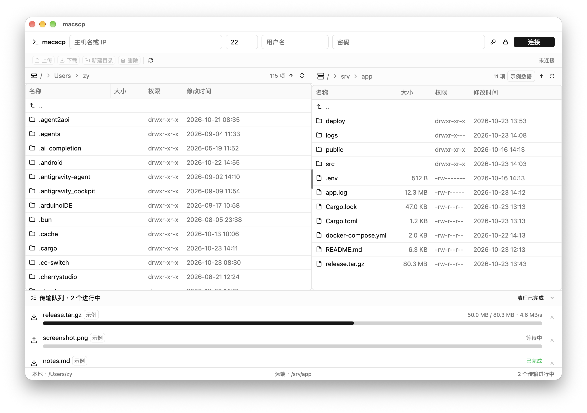
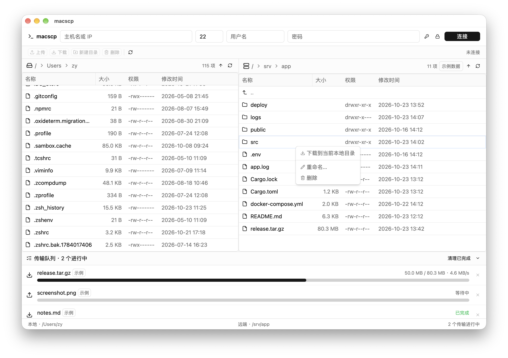
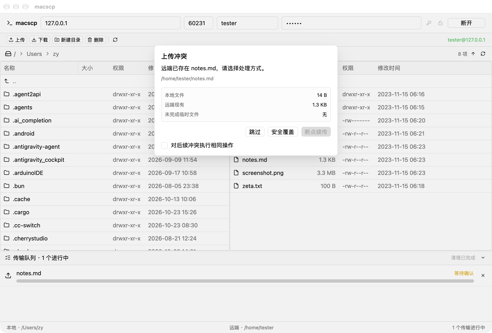

# Blip：跨平台原生 SFTP 客户端

> 文件传输，不该是一次提心吊胆的等待。

Blip 是一款面向 macOS、Windows 和 Linux 的原生 SFTP 客户端。它拥有熟悉的双栏文件管理体验，也把安全连接、
断点续传、目录传输和冲突处理做成了清晰可控的操作。



## 传文件，也可以很顺手

还在不同窗口之间反复切换？还在担心大文件传到一半断线？或者误覆盖服务器上的重要文件？

Blip 希望把这些麻烦留在后台：

- 左侧浏览本机，右侧浏览服务器，文件位置一目了然。
- 从系统文件管理器直接拖入文件或文件夹，松手即可上传。
- 大文件分块传输，实时显示进度、速度，并可随时取消。
- 文件密集目录自动使用多连接并发；多张物理网卡可同时参与上传。
- 网络中断后保留安全的临时文件，下次可以继续传。
- 遇到同名文件时，由你选择续传、安全覆盖或跳过。
- 内置局域网 SFTP 服务，让手机、平板或另一台电脑直接向本机传文件。

没有复杂命令，也不会用浏览器弹窗打断操作。所有确认都在应用内模态框中完成。

## 不只是“能传”，更要“传得安心”

### 主机身份，先确认再连接

首次连接时，Blip 会展示服务器算法与 SHA-256 主机密钥指纹。你可以仅信任本次连接，
也可以保存到标准的 `~/.ssh/known_hosts`。如果服务器密钥发生变化，应用会明确警告并
默认拒绝连接。

### 密码只进系统凭据库

连接配置与密码分开保存：主机、端口和用户名写入应用配置，密码则保存在
macOS Keychain、Windows Credential Manager 或 Linux Secret Service 中。macOS 正式签名版还会优先使用
Touch ID，并允许回退到 Mac 登录密码。
同时支持私钥认证，留空私钥路径即可自动查找常用密钥：

```text
~/.ssh/id_ed25519 → ~/.ssh/id_ecdsa → ~/.ssh/id_rsa
```

### 原文件，不到最后一刻不动

上传和下载不会直接覆盖目标。数据先写入旁边的 `.filepart`，完整传输后再替换正式文件：

```text
源文件 ──64 KiB 分块──▶ target.filepart ──完成后替换──▶ target
```

即使传输取消或意外断线，原目标仍会尽可能保持完整，半成品则留作下一次续传。

### 让这台电脑也能接收文件

Blip 启动时会同时启动一个局域网 SFTP 服务，默认监听 `2022` 端口；如果该端口已被
占用，会自动改用一个空闲端口。点击窗口底部的 `SFTP · 地址:端口` 即可查看并复制连接命令
和登录密码；登录用户名固定为 `zy`，默认密码为 `88888888`。也可以在“设置”中切换为
手动密码；手动密码保存在系统凭据库，不会写入设置文件。

共享目录默认是当前用户主目录，也可以在“设置”中选择其它文件夹，保存后立即生效。服务只
允许访问该共享目录以内的文件，退出 Blip 后自动停止。默认密码仅适合可信局域网内的临时传输，
不应把该端口直接暴露到公网。

### 自动发现同一局域网里的 Blip

连接栏的雷达按钮会列出在线的 Blip 设备，选择一项即可回填 IP、端口和用户名。每台设备
首次启动时生成并持久化一个 UUID；设备名称来自系统主机名，不会在广播里携带密码。

发现同时走两条链路：

- **UDP 定向广播**：监听 `1985/UDP`，每 3 秒重新枚举所有 `Up`、非回环且支持广播的 IPv4 网卡，
  由每个网卡的 IP 和掩码计算定向广播地址，再绑定该网卡源 IP 发送 JSON 心跳；连续 10 秒
  未收到心跳即离线。这样不会因为 Windows 的默认路由或虚拟网卡而把所有广播发到同一路径。
- **mDNS / DNS-SD**：同时注册并浏览 `_blip-sftp._tcp.local.`，由标准服务记录携带 UUID、
  主机名和 SFTP 端口。它的代码和协议更标准，在支持 Bonjour/Avahi 的网络里很稳定；但企业
  Wi-Fi、访客网络、VPN 或防火墙可能禁用组播，所以不单独依赖它。

两条链路发现的结果按 UUID 合并。若列表一直为空，请允许 Blip 访问本地网络，并放行
`1985/UDP` 和 mDNS 的 `5353/UDP`；启用客户端隔离的无线网络本身不允许设备互相发现。

Blip 支持同时打开多个传输窗口，但整台电脑只运行一套自动发现：第一个实例负责 UDP/mDNS，
其它实例通过仅监听 `127.0.0.1` 的本机协调通道共享同一份在线设备列表，各自的连接与传输
队列仍完全独立。负责发现的实例退出后，存活的其它实例会自动接管。局域网中只广播当前
发现负责实例的内置 SFTP 端口；其它实例因端口占用而启用的随机 SFTP 端口仍可手动连接，
不会重复注册成同一台设备。

## 一个文件夹，也只是一项任务

文件夹里有 5 个文件，还是 500 个文件，传输队列都只显示一项任务。进度按整批汇总，
一次取消即可停止整批传输。

使用字面量 IPv4 地址连接时，Blip 会在后台尝试为其它可到达服务器的物理网卡建立独立
SFTP 连接。最多使用 4 条连接、每条 8 路上传，总并发上限为 32；不可用网卡会自动忽略，
不会延迟主连接进入可用状态。窗口底部会显示当前“上传 N 链路 · M 路”，悬停可查看每条
连接实际绑定的本地 IPv4。

Blip 会保留空目录与隐藏文件，并跳过可能导致循环或越界访问的符号链接。递归下载还会
拒绝 `..`、绝对路径和本地符号链接逃逸，防止异常服务器把文件写到目标目录之外。



## 文件冲突，把决定权交给你

发现远端已有同名文件或残留的传输片段时，Blip 会在写入任何新数据前暂停任务：

- **断点续传**：从已有 `.filepart` 继续。
- **安全覆盖**：重新写入临时文件，完成后再替换目标。
- **跳过**：保留现有文件，不启动传输。

同一个选择也可以应用到本次会话的后续冲突，不必面对一连串重复确认。



## 日常操作，一看就会

| 你想做什么 | 怎么操作 |
| --- | --- |
| 浏览目录 | 双击文件夹，或点击面包屑快速跳转 |
| 返回上一级 | 双击 `..`，或点击标题栏 ↑ |
| 上传文件/文件夹 | 右键本地项目，或从系统文件管理器拖到右侧 |
| 下载文件/文件夹 | 右键远端项目并选择下载 |
| 编辑远端文件 | 双击打开，保存后自动同步 |
| 管理远端项目 | 右键新建目录、重命名或删除 |
| 查看传输状态 | 在底部队列查看进度、速率与结果 |

## 现在就试试

需要 Rust 工具链，支持 macOS 12+、Windows 10+ 以及使用 X11/Wayland 的桌面 Linux：

```bash
cargo run
```

没有现成的 SFTP 服务器？项目内置了一个只使用内存文件系统的演示服务器：

```bash
cargo run --features demo-server
```

应用会自动连接到本机回环地址。首次连接选择“仅本次信任”，即可体验目录浏览、上传、
下载、续传、取消和冲突处理；退出后演示数据自动消失，也不会污染 `known_hosts`。

## 原生体验，也有清晰边界

Blip 使用 GPUI Kit 构建界面，SSH/SFTP 操作则运行在独立 Tokio 线程中。UI 与网络层
只通过消息通信，让目录读取和大文件传输不会堵住渲染线程。

当前版本仍有这些限制：

- 目录上传复制安全的相对符号链接；越界链接和下载侧符号链接仍会跳过。暂不支持 `.gitignore` 或自定义排除规则。
- 整目录进度按字节汇总，暂不显示文件计数。
- 上传续传按 `.filepart` 长度判断，不计算内容校验和。
- 本地删除会进入系统回收站；远程删除是永久操作，执行前会用应用内模态框确认。
- 默认构建的 `.app` 使用 ad-hoc 签名，因此开发运行会回退到普通 Keychain；Touch ID 保护需要
  带 provisioning profile 的正式签名。对外分发还需要 Developer ID 签名和公证。

## 构建与测试

```bash
scripts/build.sh                # macOS、Linux、Windows 使用同一入口
scripts/build.sh -v 0.2.0       # 指定本次构建版本；下次构建会沿用
cargo test --all-features       # 运行完整测试
```

GitHub Actions 会在三个原生构建环境中并行生成发布包：

- `Blip-<version>-macos-arm64.dmg`
- `Blip-<version>-windows-x86_64.exe`
- `Blip-<version>-linux-x86_64.tar.gz`

可在 Actions 中手动运行“跨平台打包”，推送 `v*` 标签时也会自动执行。Windows release
必须使用 Windows SDK 的 `fxc.exe` 编译 GPUI 着色器，因此不能从 macOS 直接交叉生成可靠的发布包。

Windows 请安装 Rust、Visual Studio C++ Build Tools、Windows SDK 和 Git for Windows，
然后在 Git Bash 中执行：

```bash
./scripts/build.sh
./scripts/build.sh -v 0.2.0
```

Windows 产物是可直接运行的单个 `.exe`：已嵌入应用图标，并使用 GUI 子系统启动，运行时
不会弹出命令行窗口。

应用会在最右下角显示版本号，并在启动后异步检查 GitHub Releases。发现新版本时会用应用内
模态框提示，可直接打开发布页下载当前平台的新版本；检查失败不会影响连接和传输。

测试覆盖真实进程内 SSH/SFTP 协议链路、文件与目录传输、断点续传、取消、冲突处理及路径
逃逸防护。

---

**Blip —— 让每一次连接都看得见，让每一次传输都留有余地。**
